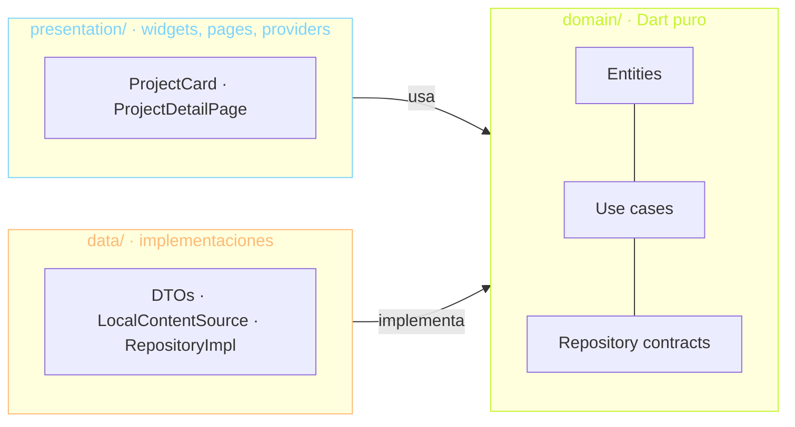

# tobias.dev — portfolio en Flutter Web

Portfolio personal de Tobias Arevalo, hecho en Flutter Web y compilado a WASM.
El código también es parte del portfolio: muestra clean architecture, tests y
CI/CD, y tiene un "modo arquitectura" que superpone las capas de cada feature
sobre la UI.

> Estado: **Fase 1 — base técnica**. Ver [PLAN.md](PLAN.md) para el roadmap
> completo y [TODO.md](TODO.md) para el contenido pendiente.
>
> Sitio: `[dominio]` (pendiente)

## Stack

| Tema | Elección |
| --- | --- |
| Plataforma | Flutter Web, `flutter build web --wasm` |
| Estado e inyección | Riverpod (`flutter_riverpod`) |
| Navegación | go_router con URLs limpias (`/`, `/en`, `/projects/:slug`) |
| i18n | `flutter_localizations` + ARB, español por defecto e inglés en `/en` |
| Lints | `very_good_analysis` + `strict-casts`/`strict-inference`/`strict-raw-types` |
| Tests | unit, widget y reglas de arquitectura |
| CI/CD | GitHub Actions → Firebase Hosting |

## Arquitectura

Cada feature (`projects`, `experience`, `contact`) se divide en tres capas.
Las dependencias apuntan siempre hacia `domain`:



- **domain** es Dart puro: no importa Flutter, `dart:ui`, `dart:io`, Riverpod
  ni otras capas.
- **data** implementa los contratos de domain y nunca importa presentation.
- **presentation** solo conoce domain; nunca importa data.
- La composición (qué implementación de data cumple cada contrato) se hace en
  `lib/app/`, sobreescribiendo providers de Riverpod en el `ProviderScope`.

Estas reglas no dependen de la buena voluntad: el test
[`test/architecture/layer_rules_test.dart`](test/architecture/layer_rules_test.dart)
recorre `lib/features/` y falla en CI si algún import las rompe.

### Estructura

```
lib/
  app/                 # PortfolioApp (MaterialApp.router), theme
  core/
    design_system/     # tokens (colores, radios, espaciado), tipografía, componentes
    l10n/              # AppLocale (idioma ↔ URL) y context.l10n
    router/            # go_router, rutas por idioma, 404
    architecture_mode/ # overlay + LayerBadge (Fase 5)
    shaders/           # fragment shaders (Fase 5)
  features/
    home/presentation/ # página de inicio (compone secciones de otros features)
    projects/{data,domain,presentation}/
    experience/{data,domain,presentation}/
    contact/{data,domain,presentation}/
  l10n/                # app_es.arb (template) y app_en.arb
assets/
  content/{es,en}/     # contenido en JSON + Markdown (Fase 2)
  cv/                  # CV en PDF (ES/EN)
  fonts/               # Bricolage Grotesque y JetBrains Mono (OFL)
```

### Idiomas y rutas

El idioma sale de la URL, no de un estado global. Cada idioma tiene su propio
`ShellRoute` que sobreescribe los `Localizations` de su subárbol:

| URL | Idioma |
| --- | --- |
| `/` | Español |
| `/en` | Inglés |
| cualquier otra | 404 en el idioma del prefijo |

### Design system

Los tokens de [PLAN.md](PLAN.md) viven en `lib/core/design_system/tokens/`. El
acento (lima `#C6F432`) se puede cambiar con `AppTheme.dark(accent: ...)`. Los
colores de las capas se exponen como `ThemeExtension` (`AppLayerColors`), así
el color de domain sigue al acento.

## Desarrollo

Requiere Flutter 3.44.0 (stable).

```bash
flutter pub get
flutter run -d chrome
```

```bash
flutter analyze
flutter test
flutter build web --wasm
```

Las traducciones se generan desde `lib/l10n/*.arb` con `flutter gen-l10n`
(también corre solo con `flutter pub get`).

## CI/CD

[`.github/workflows/ci.yml`](.github/workflows/ci.yml) corre en cada PR y push:
formato, `flutter analyze --fatal-infos`, `flutter test` y
`flutter build web --wasm`. En push a `main` despliega `build/web` a Firebase
Hosting, siempre que estén configurados la variable `FIREBASE_PROJECT_ID` y el
secret `FIREBASE_SERVICE_ACCOUNT`.

## Licencias

Las fuentes Bricolage Grotesque y JetBrains Mono se distribuyen bajo la SIL
Open Font License 1.1 (ver `assets/fonts/*-OFL.txt`).
