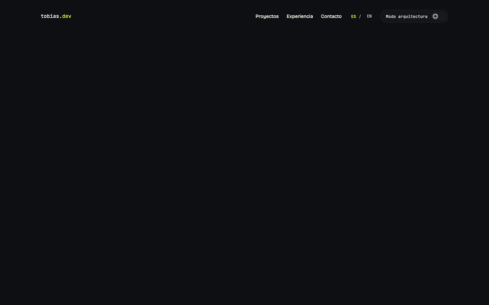
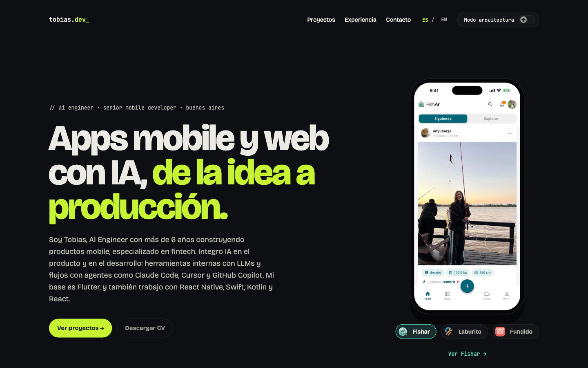
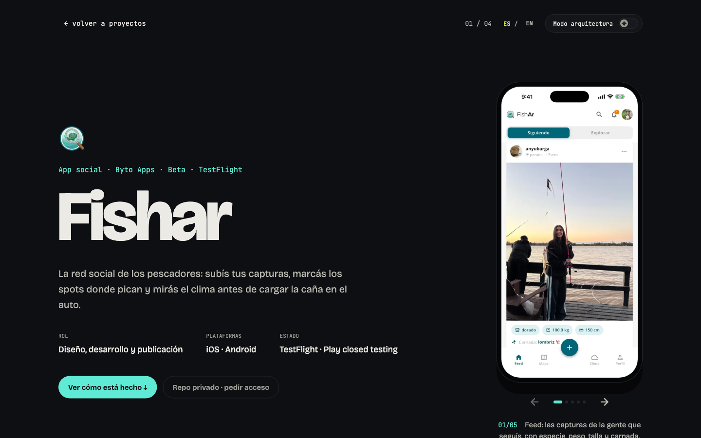
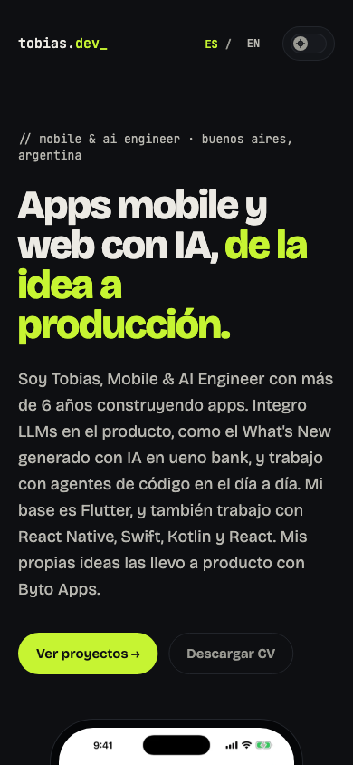
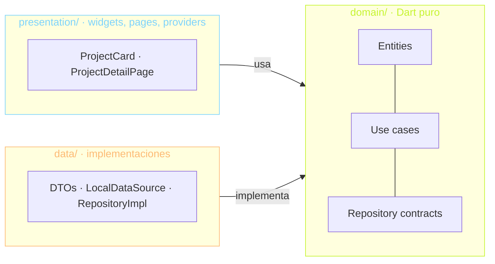

# tobias.dev — portfolio en Flutter Web

Portfolio personal de Tobias Arevalo, hecho en Flutter Web y compilado a WASM.
El código también es parte del portfolio: muestra clean architecture, tests y
CI/CD, y tiene un "modo arquitectura" que superpone las capas de cada feature
sobre la UI.

> Estado: **las 6 fases del [PLAN](PLAN.md) están implementadas**. Lo que falta es
> contenido y configuración (dominio, deploy, algunos textos): ver
> [TODO.md](TODO.md).
>
> Sitio: https://tobias-arevalo.web.app · Código: https://github.com/tarevaloit/portfolio



| Home | Detalle de proyecto | Mobile |
| --- | --- | --- |
|  |  |  |

**Qué muestra:**

- **Modo arquitectura:** un toggle superpone sobre la UI la capa de cada
  widget y la cadena real de clases detrás (widget → provider → caso de uso →
  repositorio). Un test garantiza que cada nombre exista en el código.
- **Clean architecture verificada:** un test falla si `domain` importa Flutter
  o si `presentation` importa `data`.
- **Contenido sin tocar código:** proyectos, experiencia y contacto en
  JSON/Markdown por idioma, validados en CI.
- **Detalle con capturas reales** en un carrusel, Hero transitions, fondo con fragment shader
  y reduced motion respetado en todas las animaciones.

## Stack

| Tema | Elección |
| --- | --- |
| Plataforma | Flutter Web, `flutter build web --wasm` |
| Estado e inyección | Riverpod (`flutter_riverpod`) |
| Navegación | go_router con URLs limpias (`/`, `/en`, `/projects/:slug`) |
| i18n | `flutter_localizations` + ARB, español por defecto e inglés en `/en` |
| Lints | `very_good_analysis` + `strict-casts`/`strict-inference`/`strict-raw-types` |
| Modelos | freezed (entidades) + json_serializable (DTOs) |
| Animación | flutter_animate (entradas), visibility_detector (reveal al scrollear), fragment shader propio |
| Tests | unit, widget, golden, responsive, reglas de arquitectura e integridad del contenido |
| CI/CD | GitHub Actions → Firebase Hosting |

## Arquitectura

Cada feature (`projects`, `experience`, `contact`) se divide en tres capas.
Las dependencias apuntan siempre hacia `domain`:



- **domain** es Dart puro: no importa Flutter, `dart:ui`, `dart:io`, Riverpod
  ni otras capas.
- **data** implementa los contratos de domain y nunca importa presentation.
- **presentation** solo conoce domain; nunca importa data.
- Lo compartido entre features de domain (`ContentLanguage`, `ContentFailure`)
  vive en `lib/core/domain/` y sigue las mismas reglas.

Estas reglas no dependen de la buena voluntad: el test
[`test/architecture/layer_rules_test.dart`](test/architecture/layer_rules_test.dart)
recorre `lib/features/` y `lib/core/domain/` y falla en CI si algún import las
rompe.

### Inyección de dependencias

Presentation declara cada repositorio contra su contrato de domain, sin
implementación:

```dart
final projectsRepositoryProvider = Provider<ProjectsRepository>(
  (ref) => throw UnimplementedError('...'),
);
```

La única pieza que conoce data es el composition root,
[`lib/app/di/repository_overrides.dart`](lib/app/di/repository_overrides.dart),
que sobreescribe esos providers en el `ProviderScope` de `main.dart`. Los tests
hacen lo mismo con repositorios fake o con contenido en memoria.

## Contenido

Todo el contenido vive en `assets/content/`. Lo que no depende del idioma
(orden, color, stack, links, clases por capa) está separado de los textos:

```text
assets/content/
  projects/<slug>.json          datos compartidos
  projects/<slug>.<id>.snippet  código de "Cómo está hecho", uno por entrada de `snippets`
  es/projects/<slug>.json       textos en español
  es/projects/<slug>.md         cuerpo largo en Markdown (opcional)
  en/projects/<slug>.json       textos en inglés
  experience.json · {es,en}/experience.json
  contact.json
```

- **Agregar un proyecto** es agregar `projects/<slug>.json` y
  `es/projects/<slug>.json` (y la versión `en/`). Los archivos se descubren
  desde el `AssetManifest`: no hay que tocar código.
- **Si falta una traducción**, se usa la versión en español.
- **Los JSON son estrictos**: una clave mal escrita o un tipo incorrecto es un
  error con el nombre del archivo y la clave.
  [`test/content/content_integrity_test.dart`](test/content/content_integrity_test.dart)
  carga el contenido real en ambos idiomas, así que un JSON roto falla en CI.
- **Los datos que faltan** quedan en `null` o como placeholder entre corchetes
  (`[Rol]`); ver [TODO.md](TODO.md).

### Estructura

```
lib/
  app/                 # PortfolioApp, theme y di/ (composition root)
  core/
    domain/            # kernel de dominio compartido (Dart puro)
    content/           # lectura de assets/content y parseo de JSON
    design_system/     # tokens (colores, radios, espaciado), tipografía, componentes
    l10n/              # AppLocale (idioma ↔ URL) y context.l10n
    router/            # go_router, rutas por idioma, 404
    architecture_mode/ # LayerBadge, ArchitectureMap, grilla de plano, switch
    shaders/           # BlueprintBackground (carga shaders/blueprint.frag)
  features/
    home/presentation/ # HomePage + nav, hero, métricas, Byto Apps (compone secciones de los features)
    projects/{data,domain,presentation}/
    experience/{data,domain,presentation}/
    contact/{data,domain,presentation}/
  l10n/                # app_es.arb (template) y app_en.arb
assets/
  content/{es,en}/     # contenido en JSON + Markdown (Fase 2)
  cv/                  # CV en PDF (ES/EN)
  fonts/               # Bricolage Grotesque y JetBrains Mono (OFL)
```

### Idiomas y rutas

El idioma sale de la URL, no de un estado global. Cada idioma tiene su propio
`ShellRoute` que sobreescribe los `Localizations` de su subárbol:

| URL | Idioma |
| --- | --- |
| `/` | Español |
| `/en` | Inglés |
| cualquier otra | 404 en el idioma del prefijo |

### Design system

Los tokens de [PLAN.md](PLAN.md) viven en `lib/core/design_system/tokens/`. El
acento (lima `#C6F432`) se puede cambiar con `AppTheme.dark(accent: ...)`. Los
colores de las capas se exponen como `ThemeExtension` (`AppLayerColors`), así
el color de domain sigue al acento.

## Home

La home (`features/home/presentation/pages/home_page.dart`) solo compone:
cada sección vive en el feature dueño de sus datos (`ProjectsSection`,
`ExperienceSection`, `ContactSection`) y lee su provider.

- **Responsive:** `ScreenSize` define compacto (< 768 px), medio (768–1279) y
  amplio (≥ 1280). El contenido tiene un máximo de 1200 px.
  [`responsive_test.dart`](test/features/home/responsive_test.dart) renderiza
  la home con el contenido real en ambos idiomas a 360, 768, 1280 y 1440 px y
  falla ante cualquier overflow o scroll horizontal.
- **Animaciones:** entrada escalonada del hero, reveal de cada sección al
  entrar al viewport, el teléfono del hero que rota entre las apps reales,
  marquee infinito y hover en las cards.
  Todas leen `MediaQuery.disableAnimations` y muestran el estado final con
  reduced motion.
- **Textos:** los textos fijos están en los ARB; los datos salen de
  `assets/content/`. Lo que falta se ve como placeholder (`[AÑO]`,
  `[TU EMAIL]`) y "Descargar CV" queda deshabilitado hasta que exista el PDF.

## Detalle de proyecto

`/projects/:slug` (y `/en/projects/:slug`) es una ruta hija de la home de cada
idioma: la home queda abajo en el stack, así volver conserva su scroll y la
transición puede animar entre las dos.

- **Hero transitions:** el nombre de la card crece hasta el título gigante y
  la portada de color se convierte en el teléfono (`project_heroes.dart`). El
  vuelo dibuja un texto escalado y un bloque de color, así nada se re-layoutea
  a mitad de animación. Con reduced motion no hay vuelo ni transición.
- **Capturas reales** (`widgets/detail/media_carousel.dart`): las pantallas
  de cada app dentro del teléfono, de a una, con flechas, swipe (también con
  mouse o trackpad), flechas del teclado y el epígrafe anunciado a lectores
  de pantalla. Las de la versión web (Laburito: web del Buscador y panel de
  administración) van en una ventana de navegador aparte. El tipo de cada
  imagen (`phone`, `web`, `figure`) viene del contenido. "Este portfolio"
  muestra la propia home en miniatura dentro del teléfono.
- **Cómo está hecho:** las tres capas con los nombres reales de clases que
  vienen del contenido, el código real del feature en pestañas (un archivo
  por pestaña, en el color de su capa) y el árbol de archivos del feature,
  tests incluidos; los archivos con extracto se abren desde el árbol. El
  resaltador de Dart es propio (`core/design_system/code/`), sin
  dependencias y determinista para los goldens.
- **Repos privados:** Fishar y Fundido no se linkean (Laburito sí); el botón
  arma un mail para pedir acceso (`privateSource` en el contenido).
- **Fuentes:** todos los símbolos salen de las fuentes incluidas. Lo que
  Bricolage no tiene cae en JetBrains Mono; lo que ninguna tiene se dibuja.

## Modo arquitectura

El toggle de la nav (y de la barra del detalle) superpone sobre la UI cómo
está construida:

- **Grilla de plano** sobre todas las páginas (`ArchitectureModeHost`, montado
  una sola vez en `MaterialApp.builder`).
- **`LayerBadge`** en cada sección: borde en el color de su capa y la cadena
  real de clases, por ejemplo `ProjectsSection → projectsProvider →
  GetProjects → ProjectsRepositoryImpl`. El overlay no cambia el tamaño ni la
  posición del widget. La home en miniatura de "Este portfolio" se marca
  como "maqueta".
- **Cards de proyecto:** la portada muestra las clases de cada capa de ese
  proyecto, desde el contenido.
- **Links a GitHub:** cada clase abre su archivo cuando el proyecto "Este
  portfolio" tiene `links.github` en el contenido.

Los nombres viven en
[`architecture_map.dart`](lib/core/architecture_mode/architecture_map.dart) y
[`architecture_map_test.dart`](test/architecture/architecture_map_test.dart)
verifica que cada clase exista en su archivo y que su capa coincida con la
carpeta: si se renombra algo, CI falla.

## Fondo con shader

[`shaders/blueprint.frag`](shaders/blueprint.frag) dibuja un brillo sutil que
sigue al mouse y una bruma que se mueve con el tiempo y el scroll. Con reduced
motion queda estático; si la plataforma no puede cargar el shader, se ve el
fondo liso. Los tests lo apagan con `backgroundEffectsEnabledProvider` para que
los goldens no dependan del GPU.

## Rendimiento

- **Loader instantáneo** en [`web/index.html`](web/index.html): HTML y CSS
  puros, visibles antes de que cargue el engine. Se va con el evento
  `flutter-first-frame`, que además deja el tiempo en `window.__firstFrameMs`.
- **Deferred imports:** la página de detalle (carrusel, resaltador, home en
  miniatura) es una librería aparte que se precarga después del primer frame,
  así el click en una card la encuentra lista y la Hero transition funciona.
  - Build JS (fallback para navegadores sin WasmGC): el detalle sale en un
    archivo aparte de ~125 KB.
  - Build WASM: dart2wasm (Flutter 3.44) todavía no divide el módulo;
    `main.dart.wasm` es uno solo de ~2,6 MB y `loadLibrary()` no hace nada.
- **Imágenes en WebP** con tamaño fijo (`assets/projects/`): los íconos y el
  burndown pasaron de 1,4 MB a 58 KB.
- **Shader** cargado de forma asíncrona: no bloquea el primer frame.
- **Sin service worker:** [`web/flutter_bootstrap.js`](web/flutter_bootstrap.js)
  reemplaza al de Flutter, que esperaba hasta 4 s a que se activara su service
  worker (ya deprecado) antes de cargar el engine.
- Lighthouse desktop sobre https://tobias-arevalo.web.app: Performance 95,
  interactivo en 1,7 s.

## Accesibilidad

- El árbol de semántica se construye desde el inicio
  (`SemanticsBinding.ensureSemantics()`), sin el botón oculto "Enable
  accessibility" de Flutter Web.
- `<html lang>` sigue al idioma de la ruta.
- **Teclado:** el primer Tab muestra "Saltar a los proyectos"; las cards se
  activan con Enter/Espacio; todos los botones tienen un anillo de foco visible.
- **Reduced motion:** ninguna animación corre (entradas, reveal, marquee,
  teléfono del hero, shader, Hero).
- [`accessibility_test.dart`](test/accessibility/accessibility_test.dart) corre
  las guías de Flutter (contraste de texto, botones etiquetados y objetivos de
  24×24 de WCAG 2.2) en la home y en tres detalles.

## Desarrollo

Requiere Flutter 3.44.0 (stable).

```bash
flutter pub get
dart run build_runner build --delete-conflicting-outputs
flutter run -d chrome
```

El código generado (`*.freezed.dart`, `*.g.dart`) no se commitea: después de
clonar o de cambiar una entidad o un DTO hay que correr `build_runner` (o
`dart run build_runner watch -d` mientras se desarrolla). En VS Code,
[`.vscode/launch.json`](.vscode/launch.json) trae configuraciones para Chrome,
WASM y web-server.

```bash
flutter analyze
flutter test
flutter build web --wasm
```

Los golden tests (`test/goldens/`) llevan el tag `golden` y se generan en
macOS, porque Linux renderiza el texto distinto. Para regenerarlos después de
un cambio visual:

```bash
flutter test --tags golden --update-goldens
```

Las imágenes de este README se generan con el contenido y las fuentes reales:

```bash
flutter test --run-skipped --tags screenshots
python3 tool/make_gif.py
```

Los íconos, el favicon y la imagen para previews de links salen de
[`tool/brand_assets.py`](tool/brand_assets.py) (necesita Pillow).

Las traducciones se generan desde `lib/l10n/*.arb` con `flutter gen-l10n`
(también corre solo con `flutter pub get`).

## CI/CD

[`.github/workflows/ci.yml`](.github/workflows/ci.yml) corre en cada PR y push:
generación de código, formato, `flutter analyze --fatal-infos`, `flutter test`
(sin los tests de píxeles) y `flutter build web --wasm` en Linux, y los golden
y de contraste en un job de macOS. En push a `main` despliega `build/web` al sitio
`tobias-arevalo` del proyecto de Firebase `portfolio-byto`, siempre que estén
configurados la variable `FIREBASE_PROJECT_ID` y el secret
`FIREBASE_SERVICE_ACCOUNT`. Para desplegar a mano:

```bash
flutter build web --wasm --release
firebase deploy --only hosting
```

## Licencias

Las fuentes Bricolage Grotesque y JetBrains Mono se distribuyen bajo la SIL
Open Font License 1.1 (ver `assets/fonts/*-OFL.txt`).
