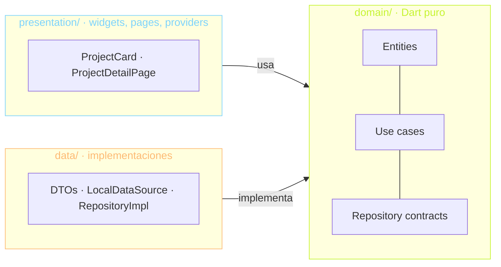

# tobias.dev — portfolio en Flutter Web

Portfolio personal de Tobias Arevalo, hecho en Flutter Web y compilado a WASM.
El código también es parte del portfolio: muestra clean architecture, tests y
CI/CD, y tiene un "modo arquitectura" que superpone las capas de cada feature
sobre la UI.

> Estado: **Fase 2 — dominio y datos**. Ver [PLAN.md](PLAN.md) para el roadmap
> completo y [TODO.md](TODO.md) para el contenido pendiente.
>
> Sitio: `[dominio]` (pendiente)

## Stack

| Tema | Elección |
| --- | --- |
| Plataforma | Flutter Web, `flutter build web --wasm` |
| Estado e inyección | Riverpod (`flutter_riverpod`) |
| Navegación | go_router con URLs limpias (`/`, `/en`, `/projects/:slug`) |
| i18n | `flutter_localizations` + ARB, español por defecto e inglés en `/en` |
| Lints | `very_good_analysis` + `strict-casts`/`strict-inference`/`strict-raw-types` |
| Modelos | freezed (entidades) + json_serializable (DTOs) |
| Tests | unit, widget, reglas de arquitectura e integridad del contenido |
| CI/CD | GitHub Actions → Firebase Hosting |

## Arquitectura

Cada feature (`projects`, `experience`, `contact`) se divide en tres capas.
Las dependencias apuntan siempre hacia `domain`:



- **domain** es Dart puro: no importa Flutter, `dart:ui`, `dart:io`, Riverpod
  ni otras capas.
- **data** implementa los contratos de domain y nunca importa presentation.
- **presentation** solo conoce domain; nunca importa data.
- Lo compartido entre features de domain (`ContentLanguage`, `ContentFailure`)
  vive en `lib/core/domain/` y sigue las mismas reglas.

Estas reglas no dependen de la buena voluntad: el test
[`test/architecture/layer_rules_test.dart`](test/architecture/layer_rules_test.dart)
recorre `lib/features/` y `lib/core/domain/` y falla en CI si algún import las
rompe.

### Inyección de dependencias

Presentation declara cada repositorio contra su contrato de domain, sin
implementación:

```dart
final projectsRepositoryProvider = Provider<ProjectsRepository>(
  (ref) => throw UnimplementedError('...'),
);
```

La única pieza que conoce data es el composition root,
[`lib/app/di/repository_overrides.dart`](lib/app/di/repository_overrides.dart),
que sobreescribe esos providers en el `ProviderScope` de `main.dart`. Los tests
hacen lo mismo con repositorios fake o con contenido en memoria.

## Contenido

Todo el contenido vive en `assets/content/`. Lo que no depende del idioma
(orden, color, stack, links, clases por capa) está separado de los textos:

```text
assets/content/
  projects/<slug>.json          datos compartidos
  projects/<slug>.snippet       snippet de "Cómo está hecho" (opcional)
  es/projects/<slug>.json       textos en español
  es/projects/<slug>.md         cuerpo largo en Markdown (opcional)
  en/projects/<slug>.json       textos en inglés
  experience.json · {es,en}/experience.json
  contact.json
```

- **Agregar un proyecto** es agregar `projects/<slug>.json` y
  `es/projects/<slug>.json` (y la versión `en/`). Los archivos se descubren
  desde el `AssetManifest`: no hay que tocar código.
- **Si falta una traducción**, se usa la versión en español.
- **Los JSON son estrictos**: una clave mal escrita o un tipo incorrecto es un
  error con el nombre del archivo y la clave.
  [`test/content/content_integrity_test.dart`](test/content/content_integrity_test.dart)
  carga el contenido real en ambos idiomas, así que un JSON roto falla en CI.
- **Los datos que faltan** quedan en `null` o como placeholder entre corchetes
  (`[Rol]`); ver [TODO.md](TODO.md).

### Estructura

```
lib/
  app/                 # PortfolioApp, theme y di/ (composition root)
  core/
    domain/            # kernel de dominio compartido (Dart puro)
    content/           # lectura de assets/content y parseo de JSON
    design_system/     # tokens (colores, radios, espaciado), tipografía, componentes
    l10n/              # AppLocale (idioma ↔ URL) y context.l10n
    router/            # go_router, rutas por idioma, 404
    architecture_mode/ # overlay + LayerBadge (Fase 5)
    shaders/           # fragment shaders (Fase 5)
  features/
    home/presentation/ # página de inicio (compone secciones de otros features)
    projects/{data,domain,presentation}/
    experience/{data,domain,presentation}/
    contact/{data,domain,presentation}/
  l10n/                # app_es.arb (template) y app_en.arb
assets/
  content/{es,en}/     # contenido en JSON + Markdown (Fase 2)
  cv/                  # CV en PDF (ES/EN)
  fonts/               # Bricolage Grotesque y JetBrains Mono (OFL)
```

### Idiomas y rutas

El idioma sale de la URL, no de un estado global. Cada idioma tiene su propio
`ShellRoute` que sobreescribe los `Localizations` de su subárbol:

| URL | Idioma |
| --- | --- |
| `/` | Español |
| `/en` | Inglés |
| cualquier otra | 404 en el idioma del prefijo |

### Design system

Los tokens de [PLAN.md](PLAN.md) viven en `lib/core/design_system/tokens/`. El
acento (lima `#C6F432`) se puede cambiar con `AppTheme.dark(accent: ...)`. Los
colores de las capas se exponen como `ThemeExtension` (`AppLayerColors`), así
el color de domain sigue al acento.

## Desarrollo

Requiere Flutter 3.44.0 (stable).

```bash
flutter pub get
dart run build_runner build --delete-conflicting-outputs
flutter run -d chrome
```

El código generado (`*.freezed.dart`, `*.g.dart`) no se commitea: después de
clonar o de cambiar una entidad o un DTO hay que correr `build_runner` (o
`dart run build_runner watch -d` mientras se desarrolla). En VS Code,
[`.vscode/launch.json`](.vscode/launch.json) trae configuraciones para Chrome,
WASM y web-server.

```bash
flutter analyze
flutter test
flutter build web --wasm
```

Las traducciones se generan desde `lib/l10n/*.arb` con `flutter gen-l10n`
(también corre solo con `flutter pub get`).

## CI/CD

[`.github/workflows/ci.yml`](.github/workflows/ci.yml) corre en cada PR y push:
generación de código, formato, `flutter analyze --fatal-infos`, `flutter test` y
`flutter build web --wasm`. En push a `main` despliega `build/web` a Firebase
Hosting, siempre que estén configurados la variable `FIREBASE_PROJECT_ID` y el
secret `FIREBASE_SERVICE_ACCOUNT`.

## Licencias

Las fuentes Bricolage Grotesque y JetBrains Mono se distribuyen bajo la SIL
Open Font License 1.1 (ver `assets/fonts/*-OFL.txt`).
